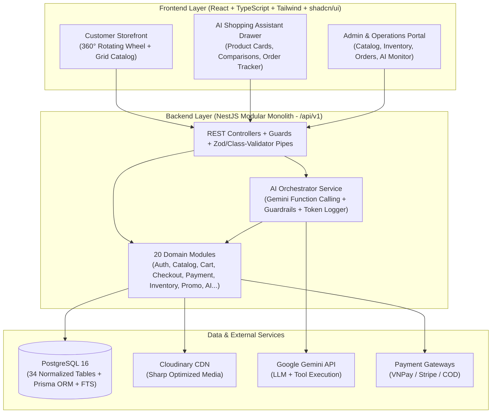

# 00. PROJECT OVERVIEW & BASELINE ASSESSMENT

> **Document ID:** `DOC-00`
> **Parent Document:** [PROJECT_MASTER_PLAN.md](file:///d:/MERN_STACK/html/ch05-nodejs/02-practice/shoppingCartBE/docs/PROJECT_MASTER_PLAN.md)
> **Version:** `1.0.0`

---

## 1. Project Identity

- **Project Name:** TechCart Pro — AI-Powered E-Commerce Platform
- **Domain:** B2C Retail E-Commerce (Consumer Electronics, Peripherals, Smart Devices & Accessories)
- **Primary Value Proposition:** Combine a high-craft interactive shopping experience (**360° Rotating Product Wheel Showcase** + fast catalog browsing) with a **grounded AI Shopping Assistant** that helps shoppers discover, compare, verify compatibility, and track orders in real time without hallucinating prices or inventory.

---

## 2. Current Codebase Inspection & Audit (As-Is State)

Before designing the target platform, a complete technical audit of the existing repository (`d:\MERN_STACK\html\ch05-nodejs\02-practice\shoppingCartBE`) was conducted.

### 2.1 Existing Directory Structure & Components

- **Backend Entry & Routing (`Express v5.1.0` + `TypeScript v5.9.3`):**
  - Entry point: [src/index.ts](file:///d:/MERN_STACK/html/ch05-nodejs/02-practice/shoppingCartBE/src/index.ts)
  - Routes: [users.routes.ts](file:///d:/MERN_STACK/html/ch05-nodejs/02-practice/shoppingCartBE/src/routes/users.routes.ts), [products.routes.ts](file:///d:/MERN_STACK/html/ch05-nodejs/02-practice/shoppingCartBE/src/routes/products.routes.ts), [carts.routes.ts](file:///d:/MERN_STACK/html/ch05-nodejs/02-practice/shoppingCartBE/src/routes/carts.routes.ts), [orders.routes.ts](file:///d:/MERN_STACK/html/ch05-nodejs/02-practice/shoppingCartBE/src/routes/orders.routes.ts), [medias.routes.ts](file:///d:/MERN_STACK/html/ch05-nodejs/02-practice/shoppingCartBE/src/routes/medias.routes.ts), [static.routes.ts](file:///d:/MERN_STACK/html/ch05-nodejs/02-practice/shoppingCartBE/src/routes/static.routes.ts)
  - Services: [database.services.ts](file:///d:/MERN_STACK/html/ch05-nodejs/02-practice/shoppingCartBE/src/services/database.services.ts), [users.services.ts](file:///d:/MERN_STACK/html/ch05-nodejs/02-practice/shoppingCartBE/src/services/users.services.ts), [products.services.ts](file:///d:/MERN_STACK/html/ch05-nodejs/02-practice/shoppingCartBE/src/services/products.services.ts), [carts.services.ts](file:///d:/MERN_STACK/html/ch05-nodejs/02-practice/shoppingCartBE/src/services/carts.services.ts), [orders.services.ts](file:///d:/MERN_STACK/html/ch05-nodejs/02-practice/shoppingCartBE/src/services/orders.services.ts), [medias.services.ts](file:///d:/MERN_STACK/html/ch05-nodejs/02-practice/shoppingCartBE/src/services/medias.services.ts)
- **Database Layer (`PostgreSQL` via `pg.Pool` + Legacy Mongo Adapter):**
  - SQL DDL: [database/schema.sql](file:///d:/MERN_STACK/html/ch05-nodejs/02-practice/shoppingCartBE/database/schema.sql) containing 5 baseline tables (`users`, `refresh_tokens`, `products`, `carts`, `orders`).
  - Adapter: `PostgresTableAdapter` in [src/services/database.services.ts](file:///d:/MERN_STACK/html/ch05-nodejs/02-practice/shoppingCartBE/src/services/database.services.ts) emulates MongoDB collection methods (`findOne`, `insertOne`, `updateOne`) over PostgreSQL and falls back to `local_db.json` if PostgreSQL is unreachable.
- **Media Pipeline (`Cloudinary` + `Sharp`):**
  - Utility: [src/utils/cloudinary.ts](file:///d:/MERN_STACK/html/ch05-nodejs/02-practice/shoppingCartBE/src/utils/cloudinary.ts) and [src/services/medias.services.ts](file:///d:/MERN_STACK/html/ch05-nodejs/02-practice/shoppingCartBE/src/services/medias.services.ts) resize/compress uploaded images via `sharp` into memory buffers, stream them to Cloudinary (`shopping_cart_be`), and remove local temp files.
- **Frontend Layer (`public/` Modular Vanilla SPA):**
  - Shell & Views: [public/index.html](file:///d:/MERN_STACK/html/ch05-nodejs/02-practice/shoppingCartBE/public/index.html), [public/views/store.html](file:///d:/MERN_STACK/html/ch05-nodejs/02-practice/shoppingCartBE/public/views/store.html), [public/views/auth.html](file:///d:/MERN_STACK/html/ch05-nodejs/02-practice/shoppingCartBE/public/views/auth.html), [public/views/dashboard.html](file:///d:/MERN_STACK/html/ch05-nodejs/02-practice/shoppingCartBE/public/views/dashboard.html)
  - Styles: [public/style.css](file:///d:/MERN_STACK/html/ch05-nodejs/02-practice/shoppingCartBE/public/style.css) + modular CSS under `public/css/` implementing the UI/UX Pro Max Light Theme and the interactive 360° Rotating Product Wheel (`#wheel-stage`).
  - Logic: [public/app.js](file:///d:/MERN_STACK/html/ch05-nodejs/02-practice/shoppingCartBE/public/app.js) + ES modules under `public/js/` (`store-wheel.js`, `cart.js`, `auth.js`, `dashboard.js`, `api.js`, `state.js`, `ui.js`, `router.js`).

### 2.2 Technical Debt & Gaps Identified in Current Prototype

| Area | Current Implementation | Target Production Requirement | Severity |
| :--- | :--- | :--- | :--- |
| **Monetary Data Types** | `DOUBLE PRECISION` in `database/schema.sql` (`price`, `original_price`, `total_amount`) | `DECIMAL(15, 2)` across all PostgreSQL tables and `Prisma.Decimal` in backend calculations | **CRITICAL** |
| **Relational Normalization** | `carts.items` and `orders.items` stored as untyped `JSONB` blobs without foreign keys | Normalized `cart_items`, `order_items`, `order_status_history` with strict FK constraints | **CRITICAL** |
| **Concurrency & Stock** | Stock checked in memory and updated without DB transaction or row lock (`race condition` prone) | ACID transaction with `SELECT ... FOR UPDATE` on `inventory` and `inventory_transactions` ledger | **CRITICAL** |
| **Password Hashing** | Salted `SHA-256` (`src/utils/crypto.ts`) | Adaptive slow hashing (`Argon2id` or `bcrypt` with cost $\ge 12$) + automatic re-hash migration on login | **HIGH** |
| **Backend Architecture** | Express v5 with Mongo-style `ObjectId` wrapper over raw `pg` | **NestJS** Modular Monolith + **Prisma ORM** + `Prisma Migrate` + DTO validation pipes | **HIGH** |
| **Frontend Architecture** | Vanilla JS DOM manipulation (`public/js/*`) | **React + Vite (or Next.js) + TypeScript + Tailwind CSS + shadcn/ui + Zustand + TanStack Query** preserving the 360° Rotating Wheel UX | **HIGH** |
| **Missing Core Modules** | Only basic Auth, 6 flat Products, basic Cart, basic COD Order | Categories tree, Product Variants/SKUs, Search/Filter pagination, Wishlist, Vouchers, Payment Webhooks, Shipments, Reviews, Notifications, Support, Admin RBAC, Analytics, AI Assistant | **HIGH** |
| **Automated Tests** | Zero unit, integration, or E2E tests | Jest unit suite, Supertest integration suite, Playwright E2E suite | **HIGH** |

---

## 3. Target System Vision (To-Be State)

---

## 4. Transition Strategy (Preserving Existing Assets)

1. **Preserve Verified Credentials & Integrations:** Reuse the verified PostgreSQL instance (`shopping_cart_be` on `localhost:5432`) and Cloudinary account (`dnpim8h29`) already configured in `.env`.
2. **Preserve the Signature 360° Rotating Wheel UX:** Port the trigonometric circular showcase (`Math.cos`/`Math.sin`, drag-to-spin, mouse-wheel orbit, keyboard navigation, split-screen detail panel) into a strongly typed React component (`<ProductWheelShowcase />`) alongside a full filterable catalog grid.
3. **Incremental Strangler/Clean Migration:** Keep legacy code inspectable during setup while scaffolding the clean NestJS + Prisma backend and React + Vite frontend under a structured workspace, migrating existing seeded products and user accounts cleanly via Prisma seed/migration scripts.

