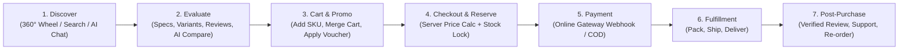

# 01. BUSINESS REQUIREMENTS DOCUMENT (BRD)

> **Document ID:** `DOC-01`
> **Parent Document:** [PROJECT_MASTER_PLAN.md](file:///d:/MERN_STACK/html/ch05-nodejs/02-practice/shoppingCartBE/docs/PROJECT_MASTER_PLAN.md)
> **Version:** `1.0.0`

---

## 1. Business Goals & Objectives

| Goal ID | Business Goal | Target Metric / KPI | Measurement Timeframe |
| :--- | :--- | :--- | :--- |
| **BG-01** | **Increase Discovery-to-Cart Conversion** via interactive 360° Wheel Showcase and fast faceted search | Add-to-Cart rate $\ge 12\%$; Checkout completion rate $\ge 3.5\%$ | Within 90 days post-launch |
| **BG-02** | **Boost Assisted Revenue via AI Shopping Assistant** | $\ge 20\%$ of sessions interacting with the AI Assistant result in product view or Add-to-Cart; $+15\%$ higher Average Order Value (AOV) on AI-assisted orders | Within 90 days post-launch |
| **BG-03** | **Eliminate Overselling & Pricing Discrepancies** | $0\%$ negative-stock orders; $100\%$ financial reconciliation accuracy between orders and payment gateway webhooks | Immediate upon launch |
| **BG-04** | **Deflect Routine Pre-Sale & Order-Tracking Support Tickets** | $\ge 60\%$ of routine inquiries (specs comparison, compatibility, return policy, order status) resolved by AI Assistant without human escalation | Within 60 days post-launch |
| **BG-05** | **Streamline Merchandising & Operations** | Admin staff can launch a new product with variants or configure a voucher campaign in $< 3$ minutes | Immediate upon launch |

---

## 2. Target Users & Personas

1. **Guest Visitor (`GUEST`):**
   - Browses the 360° Rotating Product Wheel and catalog, searches/filters products, reads reviews, adds items to a persistent guest cart, and asks the AI Shopping Assistant product/policy questions.
2. **Registered Customer (`CUSTOMER`):**
   - Manages shipping addresses, wishlists, saved carts, applies vouchers, completes online/COD checkouts, tracks shipments, submits verified product reviews, and asks the AI Assistant about their personal orders.
3. **Customer Support Agent (`SUPPORT_AGENT`):**
   - Views customer order timelines, handles escalated AI chat sessions and support tickets, processes return/cancellation requests within policy limits.
4. **Catalog & Warehouse Manager (`INVENTORY_MANAGER`):**
   - Manages categories, products, variants/SKUs, Cloudinary media galleries, stock adjustments, low-stock alerts, and fulfillment/shipment statuses.
5. **Store Administrator (`SUPER_ADMIN`):**
   - Full access to users, roles/permissions, promotions/vouchers, payment reconciliation, financial analytics, audit logs, and AI system prompts/cost budgets.

---

## 3. Stakeholder Matrix

| Stakeholder Role | Primary Concerns | Success Criteria |
| :--- | :--- | :--- |
| **Store Owner / Executive** | Revenue growth, brand differentiation, AI ROI, operational cost | High conversion, bounded AI token spend, accurate financial reporting |
| **Customers** | Fast page loads, intuitive product comparison, transparent pricing, reliable delivery | Zero checkout friction, instant accurate answers from AI Assistant |
| **Operations & Warehouse Team** | Real-time stock accuracy, clear fulfillment queue | No double-sold items, automated stock reservation & release |
| **Finance & Accounting** | Exact monetary math, tax/voucher auditability, refund tracking | Exact `DECIMAL(15,2)` ledger, immutable `payment_transactions` & `order_items` snapshots |
| **Engineering & QA Team** | Maintainability, modular boundaries, automated test coverage | Clean NestJS + Prisma + React architecture, $>80\%$ core logic test coverage |

---

## 4. Customer Pain Points & Platform Solutions

| ID | Customer Pain Point | Platform Solution |
| :--- | :--- | :--- |
| **PP-01** | Static product grids feel repetitive and fail to highlight flagship hardware products. | **Interactive 360° Rotating Product Wheel Showcase** on the hero storefront paired with an instant full-spec left panel. |
| **PP-02** | Customers struggle to compare technical specs (e.g., switch type, battery life, connectivity) across multiple peripherals. | **AI Shopping Assistant `compareProducts` tool** + structured side-by-side comparison cards in chat and UI. |
| **PP-03** | Generic chatbots hallucinate discounts, quote wrong prices, or recommend out-of-stock items. | **Strict Tool-Calling AI Architecture:** LLM is forbidden from inventing prices/stock and must query live PostgreSQL via deterministic tools. |
| **PP-04** | Losing cart items when logging in or discovering at the final step that an item is out of stock. | **Automatic Guest-to-User Cart Merge** on login + real-time stock reservation and clear price/stock change banners. |
| **PP-05** | Uncertainty about order progress after payment. | **Granular Order State Machine** (`order_status_history`), shipment tracking links, notifications, and AI order-lookup tool. |

---

## 5. High-Level Business Workflows

---

## 6. Core Business Rules (Mandatory Invariants)

- **BR-01 (Currency & Precision):** Primary store currency is **VND (`₫`)** (`currency_code CHAR(3) DEFAULT 'VND'`). All monetary values are stored in PostgreSQL as `DECIMAL(15, 2)` (supporting up to `9,999,999,999,999.99`) and rounded to 0 fractional digits (`ROUND_HALF_UP`) for `VND` (or 2 fractional digits if `USD` is configured).
- **BR-02 (Server-Side Price Authority):** Client-submitted prices, subtotals, discounts, or shipping amounts are **never** trusted. Checkout recalculates all amounts from authoritative database records.
- **BR-03 (Historical Order Immutability):** Once an order is created, `order_items` must snapshot `product_name`, `variant_sku`, `variant_attributes_snapshot`, `unit_price`, and `discount_amount` so future catalog edits never alter past financial records.
- **BR-04 (Stock Reservation & Expiration):**
  - Available stock is defined as: $\text{Available} = \text{quantity\_on\_hand} - \text{quantity\_reserved}$.
  - For **Online Payment** orders, stock is moved to `quantity_reserved` upon order creation and held for **15 minutes**. If payment succeeds, `quantity_on_hand` and `quantity_reserved` are decremented permanently. If payment fails or times out, `quantity_reserved` is released.
  - For **COD (Cash on Delivery)** orders, stock is reserved upon order creation and deducted upon shipment dispatch.
- **BR-05 (Voucher Eligibility):** Only one voucher code may be applied per order unless explicitly marked stackable. Voucher usage counts (`max_uses`, `max_uses_per_user`) are incremented atomically inside the checkout transaction.
- **BR-06 (Verified Purchase Reviews):** Only customers who have an order in `DELIVERED` status containing the target product may submit a rating and review for that product. One review per `(user_id, product_id, order_id)`.
- **BR-07 (Order Cancellation Window):** Customers may self-cancel an order only when its status is `PENDING` or `CONFIRMED` (before `PROCESSING` / `SHIPPED`). Cancelling a paid order automatically triggers a `REFUND_PENDING` workflow.

---

## 7. Project Scope Matrix (Mandatory vs. Optional vs. Out-of-Scope)

### 7.1 Mandatory Scope (P0 / P1 — Included in Core Delivery)
- Full Customer Authentication, Email Verification, Password Reset, and RBAC (`GUEST`, `CUSTOMER`, `SUPPORT_AGENT`, `INVENTORY_MANAGER`, `SUPER_ADMIN`).
- Hierarchical Categories, Products, Product Variants (SKUs, attributes like Color/Size/Switch), and Cloudinary Media Management.
- Interactive 360° Rotating Wheel Showcase + Full Search/Filter/Sort Catalog Page.
- Guest & Authenticated Shopping Cart with automatic merge and Wishlist management.
- Promotions & Vouchers engine (percentage, fixed amount, free shipping, min order value, usage limits).
- Transactional Checkout, Order State Machine, Inventory Reservation/Ledger, and Payment Integration (Payment Gateway + Webhook + COD).
- Verified Reviews & Ratings, In-App/Email Notifications, Customer Support Tickets.
- Admin Dashboard & Business/AI Analytics.
- AI Shopping Assistant with Gemini Tool-Calling, Conversation History, Guardrails, and Token/Cost Tracking.

### 7.2 Optional Enhancements (P2 / P3 — Phase-2 Expansion)
- Multi-currency live FX rate conversion at checkout.
- Social OAuth Login (Google / GitHub).
- Product bundle deals ("Frequently Bought Together" dynamic discounts).
- Exportable CSV/PDF accounting reports.

### 7.3 Explicitly Out of Scope (To Prevent Scope Creep)
- Multi-vendor marketplace (third-party sellers with split payouts / Stripe Connect).
- Native iOS / Android mobile apps (Web platform is fully responsive mobile-first).
- Physical POS (Point-of-Sale) barcode hardware integration.
- Autonomous AI actions that mutate financial state without user confirmation (AI cannot place paid orders, issue refunds, or modify database prices).

---

## 8. Assumptions & Constraints

- **AS-01:** PostgreSQL 16+ is available in both local development and production environments.
- **AS-02:** Cloudinary handles all public product and review media hosting via server-authenticated uploads.
- **AS-03:** Gemini API (`GEMINI_API_KEY`) is used for the AI Shopping Assistant; if the external LLM API experiences downtime, the core e-commerce checkout and catalog must continue operating with $100\%$ availability (graceful degradation).

