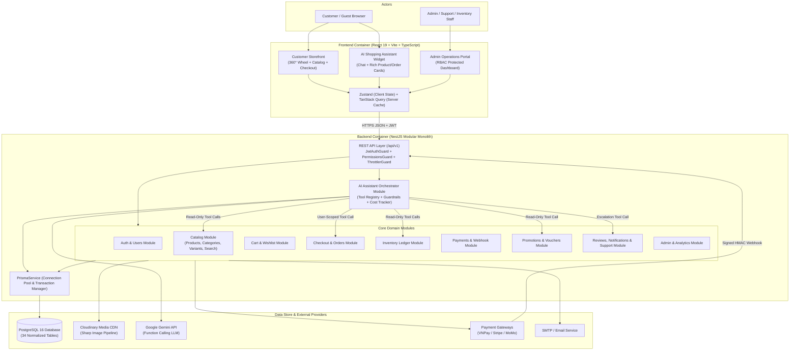

# 04. SYSTEM ARCHITECTURE SPECIFICATION

> **Document ID:** `DOC-04`
> **Parent Document:** [PROJECT_MASTER_PLAN.md](file:///d:/MERN_STACK/html/ch05-nodejs/02-practice/shoppingCartBE/docs/PROJECT_MASTER_PLAN.md)
> **Version:** `1.0.0`

---

## 1. Architectural Pattern: Modular Monolith

### 1.1 Why Modular Monolith?
Per the engineering constraints in the Master Plan, **TechCart Pro** adopts a **Modular Monolith** architecture backed by **NestJS** and **PostgreSQL 16 (Prisma ORM)** rather than premature microservices:
- **Strong ACID Transactions:** Checkout requires atomic updates across `orders`, `order_items`, `inventory`, `inventory_transactions`, `voucher_usages`, `payments`, and `cart_items`. A single PostgreSQL database transaction (`prisma.$transaction`) guarantees consistency without complex 2-Phase Commit (2PC) or Saga orchestration across network boundaries.
- **Zero Unnecessary Infrastructure Overhead:** No Redis, no Kafka/RabbitMQ, and no standalone Vector Database are required for Phase 1.
  - *Search:* Handled natively via PostgreSQL Full-Text Search (`tsvector` + `GIN` index) and `pg_trgm`.
  - *AI Grounding:* Real-time prices, stock, and orders use deterministic SQL queries via Prisma; store policies and FAQs use structured keyword/category retrieval from `store_policies` and `product_faqs` in PostgreSQL.
  - *Future Evolution Path:* Because every NestJS module communicates through explicit service interfaces and DTOs (never reaching directly into another module's internal repository logic), any module (such as `AiAssistantModule` or `NotificationsModule`) can be extracted into a separate service later if traffic exceeds single-node capacity.

---

## 2. High-Level System Context & Container Diagram



---

## 3. Repository & Workspace Structure

To cleanly transition from the existing Express prototype while maintaining full clarity, the workspace is structured as follows:

```text
shoppingCartBE/
├── docs/                          # Complete 22-document engineering specification
├── prisma/
│   ├── schema.prisma              # Authoritative 34-table PostgreSQL schema
│   ├── migrations/                # Prisma Migrate SQL history
│   └── seed.ts                    # Deterministic seed script (Roles, Categories, Products, Variants, Policies)
├── src/                           # Backend Application (NestJS Modular Monolith)
│   ├── main.ts                    # Bootstrap, Helmet, CORS, Global ValidationPipe, Swagger
│   ├── app.module.ts              # Root module wiring
│   ├── common/                    # Guards, Decorators, Interceptors, Exception Filters, Decimal utils
│   ├── config/                    # Zod-validated environment configuration
│   ├── prisma/                    # PrismaModule & PrismaService
│   └── modules/
│       ├── auth/                  # M01: JWT, Refresh rotation, Argon2id/Bcrypt, RBAC guards
│       ├── users/                 # M02: Profiles, UserAddresses, Admin User Management
│       ├── categories/            # M04: Hierarchical category tree
│       ├── products/              # M03, M05, M06: Products, Variants, Attributes, FTS Search
│       ├── media/                 # Sharp compression + Cloudinary upload stream
│       ├── carts/                 # M07: Guest & User Cart CRUD + Merge logic
│       ├── wishlists/             # M08: Wishlist CRUD + move-to-cart
│       ├── promotions/            # M13: Vouchers, Promotions, Validation engine
│       ├── inventory/             # M12: Stock reservation, deduction, release & ledger
│       ├── checkout/              # M09: Transactional checkout orchestrator
│       ├── orders/                # M10: Order state machine & status history
│       ├── payments/              # M11: Gateway adapters, HMAC webhooks, refunds
│       ├── shipping/              # M14: Shipping fee calculator & shipments tracking
│       ├── reviews/               # M15: Verified reviews & rating aggregation
│       ├── notifications/         # M16: In-app + email notifications & preferences
│       ├── support/               # M17: Customer support tickets & messages
│       ├── admin/                 # M18, M19: Admin dashboard KPIs, analytics, audit logs
│       └── ai-assistant/          # M20: Gemini tool-calling orchestrator, policies, usage logs
├── frontend/                      # Frontend Application (React 19 + Vite + TypeScript + Tailwind + shadcn/ui)
│   ├── src/
│   │   ├── components/
│   │   │   ├── ui/                # shadcn/ui primitives
│   │   │   ├── wheel/             # Interactive 360° Rotating Product Wheel Showcase
│   │   │   ├── catalog/           # Product grid, faceted filters, variant selector
│   │   │   ├── cart/              # Slide-over cart drawer, price change warnings
│   │   │   ├── ai-chat/           # Floating AI Assistant drawer, product/comparison cards
│   │   │   └── admin/             # Admin data tables, charts, inventory modals
│   │   ├── pages/                 # Public, Customer, Checkout, and Admin routes
│   │   ├── stores/                # Zustand stores (auth, wheel, guestCart, aiDrawer)
│   │   ├── hooks/                 # TanStack Query hooks
│   │   └── lib/                   # Axios/Fetch API client with automatic token refresh
├── test/                          # Jest Unit, Supertest Integration, Playwright E2E tests
├── docker-compose.yml             # PostgreSQL 16 + Backend + Frontend orchestration
└── package.json
```

---

## 4. Internal Module Layering (Clean / Hexagonal Principles inside NestJS)

Every domain module under `src/modules/<domain>/` strictly follows a 4-layer separation of concerns:
1. **Controller Layer (`*.controller.ts`):** Handles HTTP routing, status codes, Swagger metadata, `@UseGuards(JwtAuthGuard, PermissionsGuard)`, and input DTO binding. Contains **zero** business logic.
2. **DTO & Validation Layer (`dto/*.dto.ts`):** Defines strict request/response schemas validated via `class-validator` / `zod` (`whitelist: true, forbidNonWhitelisted: true`).
3. **Domain Service Layer (`*.service.ts`):** Implements business workflows, invariant checks, state machine transitions, and transaction orchestration (`prisma.$transaction`).
4. **Data Access Layer (via `PrismaService`):** Executes type-safe parameterized SQL queries and row-level locks.

---

## 5. Key Architectural Trade-Off Decisions (ADRs)

| ADR ID | Decision | Chosen Option | Rejected Alternative | Technical Justification |
| :--- | :--- | :--- | :--- | :--- |
| **ADR-01** | Backend Framework | **NestJS** (TypeScript) | Express v5 (unstructured) / Microservices | Provides strict DI, modular boundaries, guards, pipes, and OpenAPI generation out of the box while keeping a single deployable unit. |
| **ADR-02** | Product Search Engine | **PostgreSQL Native FTS (`tsvector` + `GIN`) + `pg_trgm`** | Elasticsearch / Meilisearch | Zero extra infrastructure to operate; supports weighted ranking (`name` > `brand` > `description`) and fuzzy matching inside ACID transactions for up to $100\text{k}+$ SKUs. |
| **ADR-03** | AI Knowledge Retrieval | **Hybrid Tool Calling (SQL for live data + PostgreSQL `store_policies` table for policies)** | External Vector DB (Pinecone / Qdrant / pgvector embeddings) | Product prices, stock, and order statuses change second-by-second and **must** come from exact SQL queries, never semantic vector similarity. Store policies (~20 structured sections) fit cleanly in indexed PostgreSQL tables retrieved by category/keyword tool calls. |
| **ADR-04** | Media Storage | **Sharp Memory Buffer $\rightarrow$ Cloudinary Upload Stream** | Local disk (`uploads/`) or S3 presigned client upload | Server-side Sharp pipeline strips malicious metadata, enforces max dimensions ($1200\times 1200$), converts to optimized JPEG/WebP, and leaves zero files on local disk. |
| **ADR-05** | Monetary Representation | **`DECIMAL(15, 2)` in DB + `Prisma.Decimal` in TS** | `DOUBLE PRECISION` / JS `number` | Eliminates IEEE 754 floating-point rounding bugs (e.g., `0.1 + 0.2 !== 0.3`) during multi-item voucher and tax calculations. |

