# 06. DATABASE RELATIONSHIPS & INTEGRITY SPECIFICATION

> **Document ID:** `DOC-06`
> **Parent Document:** [PROJECT_MASTER_PLAN.md](file:///d:/MERN_STACK/html/ch05-nodejs/02-practice/shoppingCartBE/docs/PROJECT_MASTER_PLAN.md)
> **Version:** `1.0.0`

---

## 1. Complete Entity-Relationship Diagram (Mermaid ERD)

```mermaid
erDiagram
    users ||--o{ user_roles : "has"
    roles ||--o{ user_roles : "assigned_to"
    roles ||--o{ role_permissions : "grants"
    permissions ||--o{ role_permissions : "included_in"
    users ||--o{ user_addresses : "owns"
    users ||--o{ refresh_tokens : "sessions"
    users ||--o| carts : "active_cart"
    users ||--o| wishlists : "wishlist"
    users ||--o{ orders : "places"
    users ||--o{ reviews : "writes"
    users ||--o{ voucher_usages : "redeems"
    users ||--o{ notifications : "receives"
    users ||--o| notification_preferences : "configures"
    users ||--o{ support_tickets : "opens"
    users ||--o{ chat_sessions : "converses"
    users ||--o{ ai_usage_logs : "consumes"
    users ||--o{ audit_logs : "performs"

    categories ||--o{ categories : "parent_of"
    categories ||--o{ products : "classifies"
    categories ||--o{ promotions : "targets"

    products ||--o{ product_images : "gallery"
    products ||--o{ product_variants : "has_skus"
    products ||--o{ reviews : "rated_by"
    products ||--o{ order_items : "referenced_in"
    products ||--o{ wishlist_items : "saved_in"

    product_attributes ||--o{ product_attribute_values : "defines"
    product_variants ||--o{ variant_attribute_values : "configured_with"
    product_attribute_values ||--o{ variant_attribute_values : "used_by"

    product_variants ||--|| inventory : "stocks"
    inventory ||--o{ inventory_transactions : "ledger"

    carts ||--o{ cart_items : "contains"
    product_variants ||--o{ cart_items : "added_as"

    wishlists ||--o{ wishlist_items : "contains"
    product_variants ||--o{ wishlist_items : "saved_variant"

    vouchers ||--o{ orders : "applied_to"
    vouchers ||--o{ voucher_usages : "tracked_in"

    orders ||--o{ order_items : "line_items"
    orders ||--o{ order_status_history : "timeline"
    orders ||--|| payments : "billed_via"
    orders ||--o| voucher_usages : "redeemed_on"
    orders ||--o{ shipments : "fulfilled_by"
    orders ||--o{ reviews : "verifies"

    payments ||--o{ payment_transactions : "gateway_logs"

    reviews ||--o{ review_images : "photos"

    support_tickets ||--o{ support_ticket_messages : "thread"
    chat_sessions ||--o{ chat_messages : "history"
    chat_sessions ||--o{ ai_usage_logs : "telemetry"
```



---

## 2. Foreign Key & Deletion Rule Matrix

To prevent orphaned records while protecting immutable financial and audit trails, every Foreign Key follows an explicit `ON DELETE` rule:

| Child Table | Foreign Key Column | Parent Table | Cardinality | `ON DELETE` Policy | Engineering Justification |
| :--- | :--- | :--- | :--- | :--- | :--- |
| `user_roles` | `user_id`, `role_id` | `users`, `roles` | M:N | `CASCADE` | Ephemeral role assignment join rows |
| `user_addresses` | `user_id` | `users` | N:1 | `CASCADE` | Historical orders snapshot the shipping address JSON; saved address book belongs solely to user |
| `refresh_tokens` | `user_id` | `users` | N:1 | `CASCADE` | Session tokens are invalid without the user |
| `categories` | `parent_id` | `categories` | N:1 | `RESTRICT` | Cannot delete a parent category that still has subcategories |
| `products` | `category_id` | `categories` | N:1 | `RESTRICT` | Cannot delete a category that contains products |
| `product_images` | `product_id` | `products` | N:1 | `CASCADE` | Gallery images belong exclusively to their product |
| `product_variants` | `product_id` | `products` | N:1 | `RESTRICT` | Variants are referenced by inventory and historical orders; archive instead of delete |
| `inventory` | `variant_id` | `product_variants` | 1:1 | `RESTRICT` | Stock records cannot be orphaned or deleted while variant exists |
| `inventory_transactions` | `inventory_id` | `inventory` | N:1 | `RESTRICT` | Immutable stock movement ledger |
| `cart_items` | `cart_id`, `variant_id` | `carts`, `product_variants` | N:1 | `CASCADE` | Ephemeral shopping cart state |
| `wishlist_items` | `wishlist_id`, `product_id` | `wishlists`, `products` | N:1 | `CASCADE` | Ephemeral wishlist state |
| `orders` | `user_id`, `voucher_id` | `users`, `vouchers` | N:1 | `RESTRICT` | Financial records must never be deleted or orphaned |
| `order_items` | `order_id`, `product_id`, `variant_id` | `orders`, `products`, `product_variants` | N:1 | `RESTRICT` | Immutable financial line items |
| `order_status_history` | `order_id` | `orders` | N:1 | `RESTRICT` | Immutable order lifecycle audit trail |
| `payments` | `order_id` | `orders` | 1:1 | `RESTRICT` | Immutable payment header |
| `payment_transactions` | `payment_id` | `payments` | N:1 | `RESTRICT` | Immutable gateway webhook and refund ledger |
| `shipments` | `order_id` | `orders` | N:1 | `RESTRICT` | Fulfillment tracking history must be preserved |
| `reviews` | `user_id`, `product_id`, `order_id` | `users`, `products`, `orders` | N:1 | `RESTRICT` | Verified purchase reviews link to the order that verified them |
| `chat_sessions` | `user_id` | `users` | N:1 | `SET NULL` | Anonymize chat history if user is purged while preserving aggregate AI telemetry |
| `chat_messages` | `chat_session_id` | `chat_sessions` | N:1 | `CASCADE` | Messages belong to their conversation session |
| `audit_logs` | `actor_user_id` | `users` | N:1 | `SET NULL` | Audit logs must survive forever even if an admin account is removed |

---

## 3. Database Transaction & Locking Boundaries

### 3.1 Transaction Boundary 1: Checkout & Stock Reservation (`PlaceOrder`)
- **Isolation Level:** `ReadCommitted` with explicit pessimistic row locking (`SELECT ... FOR UPDATE`).
- **Lock Ordering Rule:** Before checking or mutating stock, sort the cart's `variant_id` list lexicographically (`ORDER BY variant_id ASC`) and execute:
  ```sql
  SELECT id, variant_id, quantity_on_hand, quantity_reserved
  FROM inventory
  WHERE variant_id = ANY($1::uuid[])
  ORDER BY variant_id ASC
  FOR UPDATE;
  ```
  Sorting `variant_id ASC` guarantees that two concurrent checkouts with overlapping items (`[SKU_A, SKU_B]` and `[SKU_B, SKU_A]`) acquire row locks in the exact same order, making **deadlocks mathematically impossible**.
- **Atomic Steps Inside Transaction:**
  1. Lock `inventory` rows (`FOR UPDATE`).
  2. Verify `(quantity_on_hand - quantity_reserved) >= requested_qty` for every item.
  3. If a `voucher_code` is provided, lock the `vouchers` row (`FOR UPDATE`), verify `used_count < usage_limit_total` and user's count `< usage_limit_per_user`, and increment `used_count`.
  4. Insert `orders`, `order_items` (with price/name snapshots), and initial `order_status_history` (`PENDING`).
  5. Increment `inventory.quantity_reserved` and insert `RESERVE` rows into `inventory_transactions`.
  6. Insert `voucher_usages` (if applicable) and `payments` (`UNPAID`).
  7. Delete purchased rows from `cart_items`.

### 3.2 Transaction Boundary 2: Payment Webhook Confirmation (`ConfirmPayment`)
- **Atomic Steps Inside Transaction:**
  1. Check `payment_transactions` for existing `provider_transaction_id`. If found, return `200 OK` immediately (idempotent no-op).
  2. Lock `orders` and `payments` rows (`FOR UPDATE`).
  3. Insert `payment_transactions` row.
  4. Update `payments.status = 'PAID'`, `orders.payment_status = 'PAID'`, `orders.status = 'CONFIRMED'`, `orders.paid_at = NOW()`.
  5. Lock associated `inventory` rows (`ORDER BY variant_id ASC FOR UPDATE`), decrement both `quantity_on_hand` and `quantity_reserved` by `order_item.quantity`, and insert `SALE_DEDUCT` rows into `inventory_transactions`.
  6. Increment `products.sold_count` and insert `order_status_history` (`PENDING -> CONFIRMED`).

### 3.3 Transaction Boundary 3: Order Cancellation / Reservation Expiry (`CancelOrder`)
- **Atomic Steps Inside Transaction:**
  1. Lock `orders` row (`FOR UPDATE`) and verify status is `PENDING` or `CONFIRMED`.
  2. Lock associated `inventory` rows (`ORDER BY variant_id ASC FOR UPDATE`), decrement `quantity_reserved` by `order_item.quantity`, and insert `RELEASE` rows into `inventory_transactions`.
  3. If a voucher was used, decrement `vouchers.used_count` and delete/void `voucher_usages`.
  4. Update `orders.status = 'CANCELLED'`, `orders.cancelled_at = NOW()`, and insert `order_status_history`.

