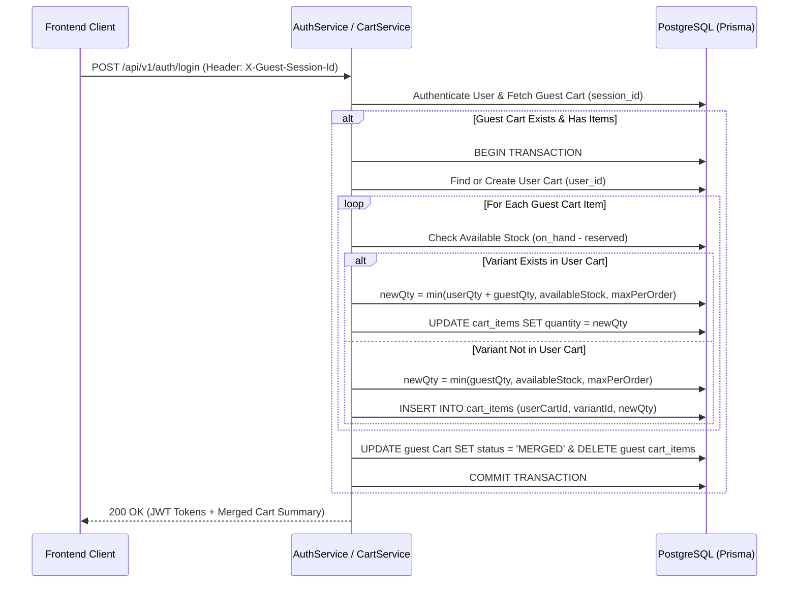
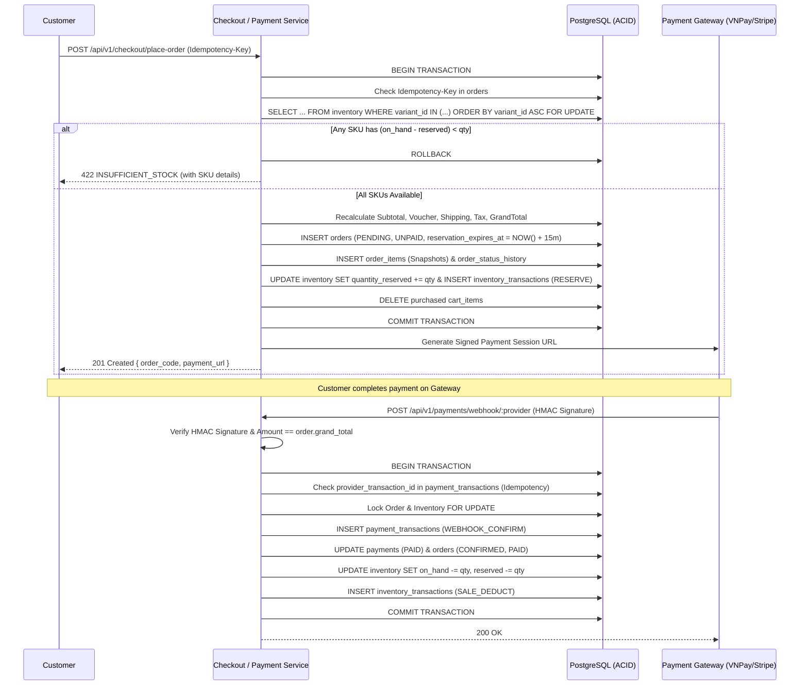
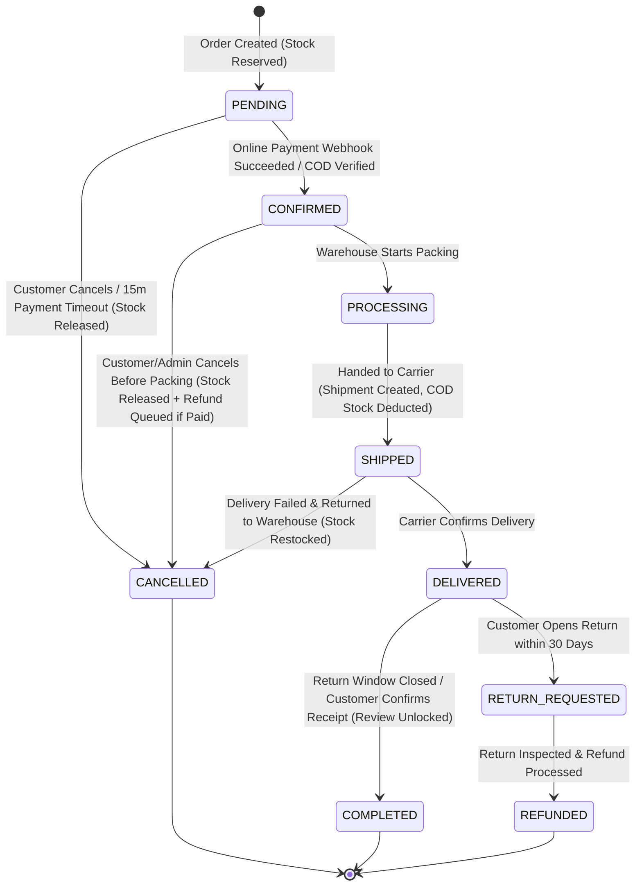

# 07. BUSINESS LOGIC & DOMAIN WORKFLOWS

> **Document ID:** `DOC-07`
> **Parent Document:** [PROJECT_MASTER_PLAN.md](file:///d:/MERN_STACK/html/ch05-nodejs/02-practice/shoppingCartBE/docs/PROJECT_MASTER_PLAN.md)
> **Version:** `1.0.0`

---

## 1. Shopping Cart Workflows

### 1.1 Add / Update Item & Price-Change Detection
1. **Variant & Stock Validation:**
   - Lookup `product_variants` joined with `products` and `inventory`.
   - Reject with `404 PRODUCT_UNAVAILABLE` if `product.status != 'ACTIVE'` or `variant.is_active == false`.
   - Compute $\text{AvailableStock} = \text{quantity\_on\_hand} - \text{quantity\_reserved}$.
   - Compute $\text{NewCartQty} = \text{ExistingCartQty} + \text{RequestedDelta}$.
   - Reject with `422 INSUFFICIENT_STOCK` if $\text{NewCartQty} > \text{AvailableStock}$, returning `{ available_stock: AvailableStock }` so the UI can adjust.
2. **Price Snapshot & Drift Warning:**
   - When an item is first inserted into `cart_items`, record `unit_price_at_add = variant.price`.
   - Whenever `GET /api/v1/cart` is called, compare `cart_item.unit_price_at_add` against current `variant.price`:
     - Always use current `variant.price` for subtotal math.
     - If `unit_price_at_add != variant.price`, emit a non-blocking warning in `cart.warnings[]`:
       `{ type: 'PRICE_CHANGED', variant_id, old_price, new_price }`.

### 1.2 Guest-to-User Cart Merge (`mergeGuestCart`)

---

## 2. Server-Side Checkout & Pricing Formulas

### 2.1 Authoritative Order Calculation Formulas
All calculations use `Prisma.Decimal` rounded to 2 decimal places (`ROUND_HALF_UP`):

1. **Line Subtotal:**
   $$\text{LineSubtotal}_i = \text{VariantPrice}_i \times \text{Quantity}_i$$
2. **Order Subtotal:**
   $$\text{Subtotal} = \sum_{i=1}^{n} \text{LineSubtotal}_i$$
3. **Voucher Discount ($\text{DiscountAmount}$):**
   - Verify `voucher.is_active == true`, $\text{NOW()} \in [\text{start\_at}, \text{end\_at}]$, and $\text{Subtotal} \ge \text{min\_order\_subtotal}$.
   - If `discount_type == 'PERCENTAGE'`:
     $$\text{RawDiscount} = \text{round}\left(\text{Subtotal} \times \frac{\text{discount\_value}}{100}, 2\right)$$
     $$\text{DiscountAmount} = \min(\text{RawDiscount}, \text{max\_discount\_amount} ?? \text{Subtotal}, \text{Subtotal})$$
   - If `discount_type == 'FIXED_AMOUNT'`:
     $$\text{DiscountAmount} = \min(\text{discount\_value}, \text{Subtotal})$$
   - If `discount_type == 'FREE_SHIPPING'`:
     $$\text{ShippingDiscount} = \text{BaseShippingFee}$$
4. **Pro-Rata Line Item Discount Allocation (for Partial Refunds):**
   Each `order_item` records its share of the order discount (`discount_allocated`) so item-level refunds are exact:
   $$\text{DiscountAllocated}_i = \text{round}\left(\text{DiscountAmount} \times \frac{\text{LineSubtotal}_i}{\text{Subtotal}}, 2\right)$$
   *(Any $0.01$ rounding remainder is allocated to the last line item so $\sum \text{DiscountAllocated}_i = \text{DiscountAmount}$).*
5. **Shipping Fee ($\text{ShippingFee}$ in VND):**
   - `STANDARD`: $30,000\text{ ₫}$ (Free if $\text{Subtotal} - \text{DiscountAmount} \ge 2,000,000\text{ ₫}$ or `FREE_SHIPPING` voucher applied).
   - `EXPRESS`: $60,000\text{ ₫}$.
   - `SAME_DAY`: $100,000\text{ ₫}$.
6. **Tax Amount ($\text{TaxAmount}$):**
   $$\text{TaxableBase} = \max(\text{Subtotal} - \text{DiscountAmount}, 0)$$
   $$\text{TaxAmount} = \text{round}(\text{TaxableBase} \times \text{TaxRate}, 2)$$
   *(Default `TaxRate` configurable via env, e.g., `0.08` or `0.00` if VAT-inclusive).*
7. **Grand Total ($\text{GrandTotal}$):**
   $$\text{GrandTotal} = \max(\text{Subtotal} - \text{DiscountAmount}, 0) + \text{ShippingFee} + \text{TaxAmount}$$

---

## 3. Checkout, Payment & Inventory Sequence Diagram

---

## 4. Order Lifecycle State Machine

### Valid State Transition Rules Table

| Current Status | Allowed Next Statuses | Actor Allowed | Side Effects |
| :--- | :--- | :--- | :--- |
| `PENDING` | `CONFIRMED`, `CANCELLED` | `CUSTOMER` (Cancel only), `SYSTEM` (Webhook/Timeout), `ADMIN` | Confirming paid order deducts `on_hand` & `reserved`; cancelling releases `reserved`. |
| `CONFIRMED` | `PROCESSING`, `CANCELLED` | `CUSTOMER` (Cancel only), `INVENTORY_MANAGER`, `ADMIN` | If already `PAID`, cancelling sets `payment_status = 'REFUND_PENDING'` and restores `on_hand`. |
| `PROCESSING` | `SHIPPED`, `CANCELLED` (Admin only) | `INVENTORY_MANAGER`, `ADMIN` | Moving to `SHIPPED` requires `tracking_number` and `carrier_name`. |
| `SHIPPED` | `DELIVERED`, `CANCELLED` (Failed Delivery) | `INVENTORY_MANAGER`, `ADMIN` | Moving to `DELIVERED` sets `delivered_at` and unlocks Verified Purchase Reviews. |
| `DELIVERED` | `COMPLETED`, `RETURN_REQUESTED` | `CUSTOMER`, `SYSTEM`, `ADMIN` | `RETURN_REQUESTED` creates a linked support/return ticket. |
| `RETURN_REQUESTED` | `REFUNDED`, `COMPLETED` (Rejected) | `SUPPORT_AGENT`, `ADMIN` | `REFUNDED` logs `payment_transactions (REFUND)` and optionally restocks inventory (`RETURN_RESTOCK`). |

