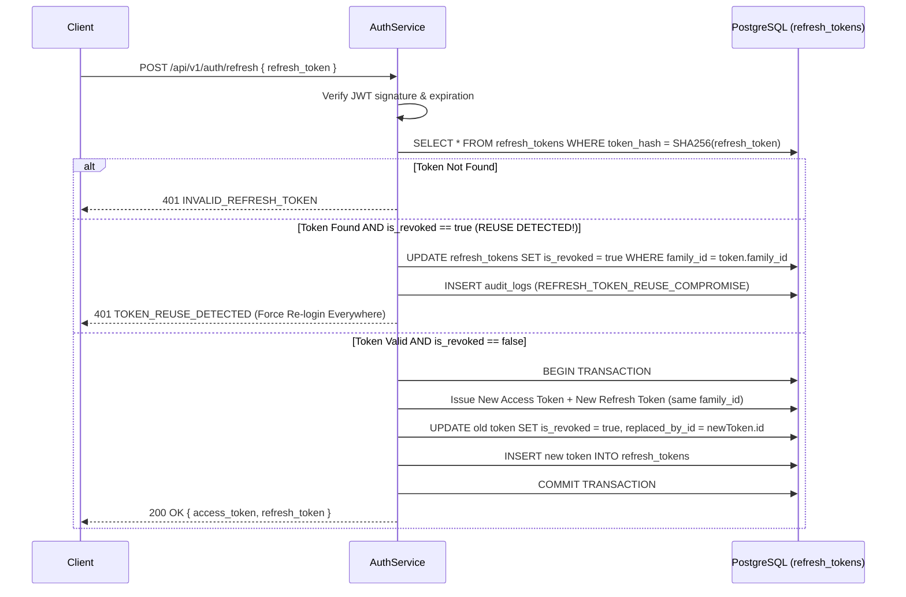

# 09. AUTHENTICATION & AUTHORIZATION SPECIFICATION

> **Document ID:** `DOC-09`
> **Parent Document:** [PROJECT_MASTER_PLAN.md](file:///d:/MERN_STACK/html/ch05-nodejs/02-practice/shoppingCartBE/docs/PROJECT_MASTER_PLAN.md)
> **Version:** `1.0.0`

---

## 1. Password Hashing & Credential Upgrade Strategy

1. **Primary Hashing Algorithm:** `bcrypt` (cost factor `12`) or `argon2id` (`memoryCost: 65536`, `timeCost: 3`, `parallelism: 4`).
2. **Seamless Legacy Hash Migration:**
   - The legacy Express prototype hashed passwords with `SHA-256(password + PASSWORD_SECRET)` (64-character hex string without `$2b$` or `$argon2id$` prefix).
   - During login (`AuthService.validateUser`):
     - If `user.password_hash` starts with `$2b$` or `$argon2id$`, verify using `bcrypt.compare` / `argon2.verify`.
     - If `user.password_hash` is a 64-char hex string, verify using legacy `sha256(password + PASSWORD_SECRET)` and, upon match, **immediately re-hash** the plaintext password with `bcrypt`/`argon2id` and update `users.password_hash` in PostgreSQL.

---

## 2. JWT Access & Rotating Refresh Token Architecture

### 2.1 Token Specifications

| Token Type | Lifetime (TTL) | Signing Secret | Payload Claims | Storage Location |
| :--- | :--- | :--- | :--- | :--- |
| **Access Token** | `15 minutes` | `JWT_ACCESS_SECRET` | `{ sub: userId, email, roles: string[], permissions: string[], type: 'ACCESS', iat, exp }` | Client memory (Zustand) + `Authorization: Bearer` header |
| **Refresh Token** | `7 days` | `JWT_REFRESH_SECRET` | `{ sub: userId, jti: tokenUuid, familyId: uuid, type: 'REFRESH', iat, exp }` | SHA-256 hashed in `refresh_tokens` table; `HttpOnly; Secure; SameSite=Lax` cookie or secure storage |
| **Email Verify / Reset Token** | `15 minutes` | `JWT_ACTION_SECRET` | `{ sub: userId, purpose: 'VERIFY_EMAIL' \| 'RESET_PASSWORD', jti, exp }` | Hashed in `users.email_verify_token` / `forgot_pass_token` |

### 2.2 Refresh Token Rotation & Reuse Detection Flow

---

## 3. Role-Based & Permission-Based Access Control (RBAC)

### 3.1 System Roles & Permission Matrix

| Permission Code | `GUEST` | `CUSTOMER` | `SUPPORT_AGENT` | `INVENTORY_MANAGER` | `SUPER_ADMIN` |
| :--- | :---: | :---: | :---: | :---: | :---: |
| `catalog.read` | ✅ | ✅ | ✅ | ✅ | ✅ |
| `cart.manage_own` | ✅ (Session) | ✅ | ✅ | ✅ | ✅ |
| `checkout.create` | ❌ | ✅ | ✅ | ✅ | ✅ |
| `orders.read_own` | ❌ | ✅ | ✅ | ✅ | ✅ |
| `orders.cancel_own` | ❌ | ✅ | ✅ | ✅ | ✅ |
| `reviews.create_verified` | ❌ | ✅ | ✅ | ✅ | ✅ |
| `support.manage_own` | ❌ | ✅ | ✅ | ✅ | ✅ |
| `ai.chat` | ✅ (Rate-limited) | ✅ | ✅ | ✅ | ✅ |
| `products.write` | ❌ | ❌ | ❌ | ✅ | ✅ |
| `categories.write` | ❌ | ❌ | ❌ | ✅ | ✅ |
| `inventory.read` / `inventory.write` | ❌ | ❌ | ❌ | ✅ | ✅ |
| `orders.read_all` | ❌ | ❌ | ✅ | ✅ | ✅ |
| `orders.write` (Status/Shipment) | ❌ | ❌ | ✅ (Cancel/Return) | ✅ (Pack/Ship) | ✅ |
| `support.manage_all` | ❌ | ❌ | ✅ | ❌ | ✅ |
| `reviews.moderate` | ❌ | ❌ | ✅ | ❌ | ✅ |
| `promotions.write` | ❌ | ❌ | ❌ | ❌ | ✅ |
| `payments.refund` | ❌ | ❌ | ❌ | ❌ | ✅ |
| `users.manage` | ❌ | ❌ | ❌ | ❌ | ✅ |
| `analytics.read` | ❌ | ❌ | ❌ | ✅ (Inventory) | ✅ |
| `ai.manage` | ❌ | ❌ | ❌ | ❌ | ✅ |
| `audit.read` | ❌ | ❌ | ❌ | ❌ | ✅ |

### 3.2 NestJS Guard Implementation Pattern
- **`JwtAuthGuard`:** Validates Bearer token; attaches `req.user = { id, email, roles, permissions }`. Supports `@Public()` decorator for public routes and `@OptionalAuth()` for hybrid routes (`/cart`, `/ai/chat`).
- **`PermissionsGuard`:** Evaluates `@RequirePermissions('products.write')` against `req.user.permissions`. If missing, throws `403 INSUFFICIENT_PERMISSIONS`.
- **Resource Ownership Enforcement:** Customer endpoints (`/orders/:orderCode`, `/users/me/addresses/:id`) always scope database queries with `WHERE user_id = req.user.id` to prevent Insecure Direct Object Reference (IDOR).

