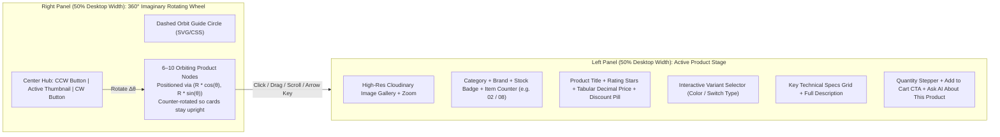

# 11. UI/UX SPECIFICATION

> **Document ID:** `DOC-11`
> **Parent Document:** [PROJECT_MASTER_PLAN.md](file:///d:/MERN_STACK/html/ch05-nodejs/02-practice/shoppingCartBE/docs/PROJECT_MASTER_PLAN.md)
> **Version:** `1.0.0`

---

## 1. Design System & Visual Direction (UI/UX Pro Max Light Theme)

Following our **UI/UX Pro Max** design foundation established in the prototype, the platform uses a crisp, high-contrast **Pure White & Slate Light Mode** aesthetic optimized for hardware and electronics photography.

### 1.1 Color Tokens (Tailwind CSS & CSS Variables)

| Token Name | Hex / Value | Usage | Contrast Ratio |
| :--- | :--- | :--- | :--- |
| `--bg-primary` | `#FFFFFF` | Main viewport background, product showcase stage, cards | Base |
| `--bg-secondary` | `#F8FAFC` (Slate 50) | Page canvas, filter sidebars, table headers, subtle containers | — |
| `--bg-tertiary` | `#F1F5F9` (Slate 100) | Pills, badges, input backgrounds, inactive tabs | — |
| `--text-primary` | `#0F172A` (Slate 900) | Headings, product titles, prices, primary copy | $17.4:1$ on `#FFF` (AAA) |
| `--text-secondary` | `#475569` (Slate 600) | Descriptions, specifications labels, secondary metadata | $7.5:1$ on `#FFF` (AAA) |
| `--text-muted` | `#64748B` (Slate 500) | Captions, timestamps, strike-through compare prices | $4.8:1$ on `#FFF` (AA) |
| `--accent-primary` | `#2563EB` (Blue 600) | Primary CTAs, active wheel node ring, AI assistant accent | $5.1:1$ on `#FFF` (AA) |
| `--accent-hover` | `#1D4ED8` (Blue 700) | Primary button hover/active state | $6.7:1$ on `#FFF` (AA) |
| `--status-success` | `#16A34A` (Green 600) | In-stock badge, verified purchase badge, payment success | — |
| `--status-warning` | `#D97706` (Amber 600) | Low-stock alert, price-change warning, pending status | — |
| `--status-danger` | `#DC2626` (Red 600) | Discount badge (`-20%`), out-of-stock, validation error | — |
| `--border-subtle` | `#E2E8F0` (Slate 200) | Hairline borders (`1px solid`), card dividers, wheel orbit ring | — |

### 1.2 Typography & Spacing Scale
- **Primary Sans Font:** `'Plus Jakarta Sans'`, `'Inter'`, system-ui (`font-sans`).
- **Numeric / Price & SKU Font:** `'JetBrains Mono'` or `font-variant-numeric: tabular-nums` so prices, stock counts, and order codes never jitter during updates.
- **Border Radius:** `rounded-xl` (`12px`) for cards/inputs, `rounded-2xl` (`16px`) for modals/showcase panels, `rounded-full` for orbiting wheel nodes and badges.

---

## 2. Signature Feature: Split-Screen 360° Rotating Product Wheel Showcase

### 2.1 Wheel Interaction Mechanics (`<ProductWheelShowcase />`)
- **Trigonometric Positioning:** Each product $i \in \{0 \dots N-1\}$ is placed at angle $\theta_i = \theta_{\text{offset}} + i \cdot \frac{2\pi}{N}$. The active selected item smoothly animates to the **9 o'clock ($180^\circ$ / $\pi\text{ rad}$)** position facing the Left Product Detail Panel.
- **4 Input Modalities:**
  1. **Click Any Node:** Shortest-path angular interpolation ($\Delta\theta \in [-\pi, \pi]$) snaps the clicked product to the active slot and updates the Left Panel immediately.
  2. **Pointer Drag-to-Spin:** `pointerdown` / `pointermove` / `pointerup` computes `Math.atan2(y - cy, x - cx)` angular delta during drag and snaps to the nearest product on release.
  3. **Mouse Wheel Orbit:** Scrolling over the wheel stage advances next/previous product with debounce.
  4. **Keyboard & Center Hub Controls:** `ArrowLeft` / `ArrowRight` and Center Hub CCW/CW buttons rotate one step at a time.

---

## 3. Complete Screen & Page Architecture

### 3.1 Public & Customer Screens
1. **Home / Flagship Showcase (`/`)**:
   - Top sticky navigation bar (Logo, Search Bar with instant autocomplete dropdown, View Switcher: `360° Wheel View` vs. `Catalog Grid View`, Wishlist badge, Cart drawer trigger, AI Assistant trigger, User Menu).
   - Split-Screen 360° Rotating Wheel Showcase (Left: Product Details & Variant Picker; Right: Interactive 360° Wheel).
   - Below-the-fold: Category Showcase Strip, Flash Promotions Banner, and Full Filterable Catalog Section.
2. **Catalog & Search Results Page (`/products`)**:
   - Left Faceted Filter Sidebar (Category tree, Brand checkboxes, Price range slider/inputs, Minimum star rating, In-stock toggle, Dynamic attribute chips).
   - Active filter pills bar + Sort dropdown (`Relevance`, `Price: Low to High`, `Price: High to Low`, `Best Selling`, `Top Rated`, `Newest`).
   - Responsive 3/4-column Product Card Grid + Pagination controls.
3. **Product Detail Page (`/products/:slug`)**:
   - Multi-image Cloudinary gallery with thumbnail strip, Variant attribute selector with live SKU/stock/price updates, Shipping fee estimator, "Ask AI to Compare" button, Full Specifications table, Verified Purchase Reviews & Rating distribution chart, and Related Products carousel.
4. **Slide-Over Cart Drawer & Full Cart Page (`/cart`)**:
   - Line items with variant attributes, quantity steppers, stock limit indicators, price-change warning banners (`warnings[]`), Voucher code input with instant preview savings, and "Proceed to Checkout" CTA.
5. **Multi-Step / Single-Page Checkout (`/checkout`)**:
   - Step 1: Saved Shipping Address selector or new address form (`React Hook Form + Zod`).
   - Step 2: Shipping Method selection (`STANDARD`, `EXPRESS`, `SAME_DAY`).
   - Step 3: Voucher application & Payment Method selection (`VNPay`, `Stripe`, `COD`).
   - Right Sticky Order Summary showing live server-calculated `Subtotal`, `Voucher Discount`, `Shipping Fee`, `Tax`, and `Grand Total`.
6. **Customer Dashboard (`/account/*`)**:
   - **Profile & Security (`/account/profile`)**: Personal info, Cloudinary Avatar upload, Password change.
   - **Address Book (`/account/addresses`)**: Manage shipping addresses & default badge.
   - **Order History & Detail (`/account/orders`, `/account/orders/:orderCode`)**: Status filter tabs, visual Order Status Timeline stepper (`PENDING` $\rightarrow$ `CONFIRMED` $\rightarrow$ `PROCESSING` $\rightarrow$ `SHIPPED` $\rightarrow$ `DELIVERED`), Shipment tracking link, Cancel Order modal, and "Write a Review" modal for delivered items.
   - **Wishlist (`/account/wishlist`)**: Saved items with one-click "Move to Cart".
   - **Support Tickets (`/account/support`)**: Ticket list and message thread view.

### 3.2 AI Shopping Assistant UI (`<AiShoppingAssistantDrawer />`)
- **Floating Trigger & Slide-Over Drawer:** Accessible from every storefront page (`Ctrl+K` or floating bottom-right button).
- **Context Awareness Pill:** When opened on a Product Detail Page or while viewing a product on the 360° Wheel, displays a context pill: *"Currently viewing: Sony WH-1000XM5"* with quick prompts (*"Compare with Bose QC Ultra"*, *"Is this good for gaming?"*, *"Check warranty & return policy"*).
- **Rich Interactive Message Components:**
  - **AI Product Cards:** Thumbnail, title, exact `DECIMAL` price, stock badge, **"Spin on Wheel"** button, and **"Add to Cart"** button directly inside the chat stream.
  - **AI Side-by-Side Comparison Table:** Structured attribute matrix comparing 2–4 products.
  - **AI Order Tracker Card:** Live status timeline badge for authenticated customer order inquiries.
  - **Human Escalation Card:** One-click button to convert the chat into an official Customer Support Ticket.

### 3.3 Admin Operations Portal (`/admin/*`)
- **Admin Overview (`/admin`)**: 5 KPI metric cards, Revenue & Order volume area chart, Low-Stock alert table, Recent Orders feed.
- **Catalog Manager (`/admin/products`, `/admin/categories`)**: Product CRUD modal/drawer, Variant matrix generator, Cloudinary multi-image drag-and-drop uploader, "Feature on 360° Wheel" toggle.
- **Inventory Ledger (`/admin/inventory`)**: Real-time `on_hand` vs. `reserved` vs. `available` stock table, "Adjust / Restock" modal, and immutable `inventory_transactions` history drawer.
- **Orders & Shipments (`/admin/orders`)**: Status transition actions, Shipment tracking creation modal, Payment & Refund manager.
- **Promotions & Vouchers (`/admin/vouchers`)**: Voucher campaign builder & usage analytics.
- **AI Assistant Monitor (`/admin/ai`)**: Store policy editor (`store_policies`), token/cost usage chart (`ai_usage_logs`), and escalated conversation viewer.
- **Users & Audit Logs (`/admin/users`, `/admin/audit-logs`)**: Role assignment and filterable JSON diff viewer for `audit_logs`.

---

## 4. UI States & Edge-Case Handling

Every screen and component must implement 4 explicit states:
1. **Loading State:** Shimmer skeleton placeholders matching exact card/table geometry (no layout shift).
2. **Empty State:** Friendly illustration + clear explanation + primary recovery CTA (e.g., Empty Cart $\rightarrow$ *"Explore the 360° Product Showcase"*).
3. **Validation & Domain Error State:** Inline field-level Zod messages + toast notification with actionable recovery (e.g., if stock drops during checkout, highlight the specific cart item and offer one-click adjustment to available quantity).
4. **Network / AI Degradation State:** If the AI provider times out, display a clean fallback banner inside the chat widget offering instant keyword search links.

