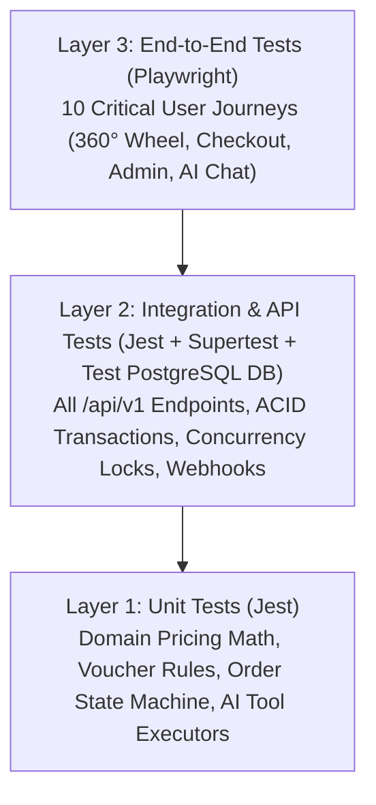

# 13. TESTING STRATEGY & QUALITY ASSURANCE

> **Document ID:** `DOC-13`
> **Parent Document:** [PROJECT_MASTER_PLAN.md](file:///d:/MERN_STACK/html/ch05-nodejs/02-practice/shoppingCartBE/docs/PROJECT_MASTER_PLAN.md)
> **Version:** `1.0.0`

---

## 1. Testing Pyramid & Coverage Targets

| Test Layer | Runner & Tools | Minimum Coverage Target | Execution Trigger |
| :--- | :--- | :--- | :--- |
| **Unit Tests** | `Jest` + `ts-jest` | $\ge 85\%$ on Domain Services (`Checkout`, `Inventory`, `Voucher`, `OrderStateMachine`, `AiToolExecutor`) | Pre-commit & every PR |
| **Integration Tests** | `Jest` + `Supertest` + Dedicated PostgreSQL Test Schema | $100\%$ of P0/P1 REST endpoints & transactional rollbacks | Every PR & CI build |
| **E2E Browser Tests** | `Playwright` (Chromium) | 100% of 10 Critical Customer & Admin Journeys | Pre-merge to `main` & release gate |

---

## 2. Critical Test Scenarios by Layer

### 2.1 Unit Test Suite (`test/unit/*.spec.ts`)
1. **Monetary & Voucher Math (`checkout-pricing.spec.ts`):**
   - Exact `Prisma.Decimal` calculation of line subtotals, percentage vouchers with `max_discount_amount` cap, fixed vouchers exceeding subtotal (clamped to `0`), pro-rata line-item discount allocation (`sum(allocated) == discount_amount`), free shipping thresholds, and tax rounding.
2. **Order State Machine (`order-state-machine.spec.ts`):**
   - Verifies all legal transitions (`PENDING -> CONFIRMED -> PROCESSING -> SHIPPED -> DELIVERED -> COMPLETED`) and rejects all illegal transitions (`DELIVERED -> CANCELLED`, `CANCELLED -> SHIPPED`).
3. **Refresh Token Rotation & Reuse (`auth-tokens.spec.ts`):**
   - Verifies token rotation invalidates previous token and triggers family-wide revocation when a rotated token is presented a second time.
4. **AI Tool Executor & Guardrails (`ai-tools.spec.ts`):**
   - Verifies `getMyOrderStatus` uses `verifiedUserContext.userId` and refuses access to another user's `order_code`; verifies prompt injection patterns are stripped or refused.

### 2.2 Integration & Database Concurrency Tests (`test/integration/*.e2e-spec.ts`)
1. **Concurrent Flash-Sale Checkout Race Condition Test (`concurrent-checkout.e2e-spec.ts`):**
   - **Setup:** Seed a product variant with `quantity_on_hand = 1, quantity_reserved = 0`.
   - **Action:** Fire 5 simultaneous `POST /api/v1/checkout/place-order` requests using `Promise.all`.
   - **Expected Assertion:** Exactly **1** request returns `201 Created` (`quantity_reserved = 1`), and **4** requests return `422 INSUFFICIENT_STOCK`. Database `quantity_on_hand >= quantity_reserved` invariant holds.
2. **Idempotency Key Replay Test (`checkout-idempotency.e2e-spec.ts`):**
   - Sending `POST /api/v1/checkout/place-order` twice with the same `Idempotency-Key` returns the exact same `order_code` without creating a second order or reserving stock twice.
3. **Payment Webhook Signature & Idempotency Test (`payment-webhook.e2e-spec.ts`):**
   - Rejects webhook with invalid HMAC signature (`401`).
   - Accepts valid HMAC webhook (`200`), transitions order to `CONFIRMED` / `PAID`, and deducts `quantity_on_hand` & `quantity_reserved`.
   - Replaying the identical webhook payload returns `200` with zero duplicate stock deductions.
4. **Guest-to-User Cart Merge Test (`cart-merge.e2e-spec.ts`):**
   - Verifies guest cart items merge accurately into user cart upon `/api/v1/auth/login` and cap quantities at `available_stock`.

### 2.3 End-to-End Playwright Suite (`test/e2e/*.spec.ts`)
1. **E2E-01:** Storefront loads in Light Mode; user rotates the **360° Rotating Product Wheel** via click and keyboard arrows; Left Panel updates product image, price, and specs in real time.
2. **E2E-02:** Guest searches and filters catalog by category and price range, adds variant to cart, registers/logs in, and verifies guest cart merges seamlessly.
3. **E2E-03:** Customer applies voucher `WELCOME10`, completes checkout, views order timeline in Dashboard, and self-cancels a `PENDING` order (verifying stock is restored).
4. **E2E-04:** Customer opens the **AI Shopping Assistant**, asks to compare two keyboards, clicks "Add to Cart" directly from the AI Product Card, and asks for return policy.
5. **E2E-05:** Admin logs in, creates a new product with Cloudinary image and variants, adjusts inventory stock, advances an order to `SHIPPED` with tracking number, and verifies entry in `audit_logs`.

