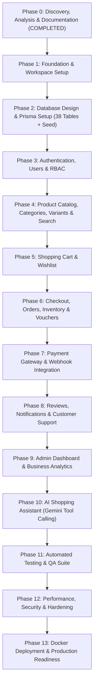

# 16. PROJECT ROADMAP & PHASE BREAKDOWN

> **Document ID:** `DOC-16`
> **Parent Document:** [PROJECT_MASTER_PLAN.md](file:///d:/MERN_STACK/html/ch05-nodejs/02-practice/shoppingCartBE/docs/PROJECT_MASTER_PLAN.md)
> **Version:** `1.0.0`

---

## 1. End-to-End Delivery Flow

---

## 2. Detailed Phase Specifications

### PHASE 0 — Project Discovery, Analysis & Documentation (`COMPLETED`)
- **Objectives:** Audit current repository, establish architecture, and write all 22 core engineering specifications in `docs/`.
- **Prerequisites:** Repository access and `.env` verification.
- **Complexity:** High
- **Deliverables:** `docs/00_PROJECT_OVERVIEW.md` through `docs/20_CHANGELOG.md` + `docs/PROJECT_MASTER_PLAN.md`.
- **Definition of Done (DoD):** All 22 documents created, cross-linked, internally consistent across ERD/Prisma/API/FRS, and presented for user approval.

---

### PHASE 1 — Foundation & Project Setup
- **Objectives:** Scaffold the clean NestJS modular monolith backend and React + Vite + TypeScript + Tailwind + shadcn/ui frontend while preserving existing `.env` credentials and Cloudinary utilities.
- **Prerequisites:** User approval of Phase 0.
- **Tasks & Subtasks:**
  1. Configure NestJS core (`@nestjs/core`, `@nestjs/common`, `@nestjs/config`, `@nestjs/swagger`, `@nestjs/throttler`, `class-validator`, `class-transformer`, `zod`).
  2. Configure global `ValidationPipe`, `AllExceptionsFilter`, `RequestIdInterceptor`, and `Decimal` money utility (`src/common/utils/money.util.ts`).
  3. Scaffold `frontend/` (`React 19 + Vite + TypeScript + Tailwind CSS + shadcn/ui + Zustand + TanStack Query + React Hook Form + Zod`).
  4. Implement `GET /api/v1/health` checking PostgreSQL and Cloudinary status.
- **Complexity:** Medium
- **Testing & DoD:** `npx tsc --noEmit` passes; `/api/v1/health` returns `200 OK`; `/api/v1/docs` renders Swagger UI.

---

### PHASE 2 — Database Design & Prisma Setup
- **Objectives:** Implement the 38-table normalized PostgreSQL schema via Prisma, apply SQL `CHECK` constraints and `tsvector` search indexes, and seed comprehensive initial data.
- **Prerequisites:** Phase 1 complete.
- **Tasks & Subtasks:**
  1. Create `prisma/schema.prisma` matching [05_DATABASE_DESIGN.md](file:///d:/MERN_STACK/html/ch05-nodejs/02-practice/shoppingCartBE/docs/05_DATABASE_DESIGN.md).
  2. Run `prisma migrate dev --name init_ecommerce_platform` and append custom SQL `CHECK` constraints (`quantity_on_hand >= quantity_reserved`, `base_price >= 0`) and `GIN` full-text search index.
  3. Build idempotent `prisma/seed.ts` seeding 4 roles, 24 permissions, 4 test accounts, 6 categories, 12 products (including the 6 signature 360° Wheel products with variants and inventory), 3 vouchers, and 6 store policies.
- **Complexity:** High
- **Testing & DoD:** Migration applies cleanly on PostgreSQL (`shopping_cart_be`); seed script populates all tables with zero errors.

---

### PHASE 3 — Authentication, Users & RBAC
- **Objectives:** Deliver secure Argon2id/Bcrypt authentication, rotating refresh tokens with reuse detection, RBAC guards, user profile management, Cloudinary avatar upload, and shipping address book.
- **Prerequisites:** Phase 2 complete.
- **Complexity:** High
- **Deliverables:** `AuthModule`, `UsersModule`, `MediaModule`, Frontend Login/Register/Forgot-Password & Account Profile/Address views.
- **Testing & DoD:** Unit & Supertest integration tests pass for register, login, legacy SHA-256 auto-upgrade, refresh token rotation, token reuse family revocation, and RBAC permission guards.

---

### PHASE 4 — Product Catalog, Categories, Variants & Search
- **Objectives:** Implement hierarchical categories, products, variants/SKUs, attributes, PostgreSQL FTS search/filtering, and port the interactive **360° Rotating Product Wheel Showcase** + Catalog Grid to React.
- **Prerequisites:** Phase 3 complete.
- **Complexity:** High
- **Deliverables:** `CategoriesModule`, `ProductsModule`, React `<ProductWheelShowcase />`, `<CatalogFilterPage />`, and `<ProductDetailPage />`.
- **Testing & DoD:** 360° Wheel rotates smoothly at 60 FPS via click, drag, scroll, and keyboard; faceted search returns accurate results and facet counts in $< 250\text{ms}$.

---

### PHASE 5 — Shopping Cart & Wishlist
- **Objectives:** Build guest (`X-Guest-Session-Id`) and authenticated cart management, stock/price-drift validation, automatic login cart merge, and customer wishlists.
- **Prerequisites:** Phase 4 complete.
- **Complexity:** Medium
- **Deliverables:** `CartsModule`, `WishlistsModule`, React Slide-Over Cart Drawer & Wishlist page.
- **Testing & DoD:** Guest-to-user cart merge and price-change warning tests pass.

---

### PHASE 6 — Checkout, Orders, Inventory & Vouchers
- **Objectives:** Implement the transactional checkout engine with `SELECT ... FOR UPDATE` row locking, `Idempotency-Key` protection, server-side Decimal pricing/voucher math, `inventory_transactions` ledger, and Order State Machine.
- **Prerequisites:** Phase 5 complete.
- **Complexity:** Very High
- **Deliverables:** `PromotionsModule`, `InventoryModule`, `ShippingModule`, `CheckoutModule`, `OrdersModule`, React Checkout & Order Timeline pages.
- **Testing & DoD:** Concurrent flash-sale race condition test (5 simultaneous checkouts for 1 unit of stock) passes with zero overselling.

---

### PHASE 7 — Payment Integration
- **Objectives:** Integrate online payment adapters (VNPay / Stripe sandbox + COD), HMAC-verified webhook reconciliation, idempotency via `provider_transaction_id`, 15-minute unpaid reservation expiry job, and refunds.
- **Prerequisites:** Phase 6 complete.
- **Complexity:** High
- **Deliverables:** `PaymentsModule`, Payment Gateway Return/Webhook handlers, Expired Order Cron Job.
- **Testing & DoD:** Spoofed webhook rejected (`401`); duplicate valid webhook processed idempotently (`200`); expired unpaid order releases reserved stock.

---

### PHASE 8 — Reviews, Notifications & Customer Support
- **Objectives:** Implement verified-purchase reviews with Cloudinary photos, automatic product rating recalculation, in-app/email notifications, and customer support tickets.
- **Prerequisites:** Phase 7 complete.
- **Complexity:** Medium
- **Deliverables:** `ReviewsModule`, `NotificationsModule`, `SupportModule`, Frontend Review modal, Notification bell, and Support center.
- **Testing & DoD:** Unverified buyer blocked (`403`) from reviewing; verified buyer review updates `products.rating_avg` atomically.

---

### PHASE 9 — Admin Dashboard & Analytics
- **Objectives:** Build role-protected Admin APIs and UI for Catalog CRUD, Variant/Inventory adjustments, Order/Shipment processing, Voucher management, Sales/Conversion charts, and `audit_logs` inspection.
- **Prerequisites:** Phase 8 complete.
- **Complexity:** High
- **Deliverables:** `AdminModule`, `AnalyticsModule`, React `/admin/*` portal.
- **Testing & DoD:** All admin mutations require matching permission (`products.write`, `inventory.write`, etc.) and record diffs in `audit_logs`.

---

### PHASE 10 — AI Shopping Assistant
- **Objectives:** Implement the Gemini Tool-Calling Orchestrator (`AiAssistantModule`) with 8 deterministic tools, SQL & Policy grounding, prompt-injection defense, token/cost logging (`ai_usage_logs`), and the rich interactive `<AiShoppingAssistantDrawer />` UI.
- **Prerequisites:** Phase 9 complete.
- **Complexity:** High
- **Deliverables:** `AiAssistantModule`, 8 tool executors, AI Chat Drawer with Product Cards, Comparison Tables, Order Cards, and Admin AI Policy/Cost monitor.
- **Testing & DoD:** Zero hallucinated prices/stock; IDOR order check blocked; graceful fallback when Gemini API is unreachable.

---

### PHASE 11 — Testing & Quality Assurance
- **Objectives:** Complete comprehensive Unit, Supertest Integration, and Playwright E2E test suites and fix any regressions.
- **Prerequisites:** Phase 10 complete.
- **Complexity:** High
- **Deliverables:** `test/unit/*`, `test/integration/*`, `test/e2e/*`, coverage report ($\ge 85\%$ domain coverage).

---

### PHASE 12 — Performance, Security & Hardening
- **Objectives:** Audit OWASP controls, tune PostgreSQL indexes with `EXPLAIN ANALYZE`, verify rate limiters, Helmet CSP headers, and Lighthouse performance/accessibility scores.
- **Prerequisites:** Phase 11 complete.
- **Complexity:** Medium

---

### PHASE 13 — Deployment & Production Readiness
- **Objectives:** Finalize multi-stage Dockerfiles, `docker-compose.yml`, GitHub Actions CI/CD workflow, backup scripts, and final production sign-off.
- **Prerequisites:** Phase 12 complete.
- **Complexity:** Medium

